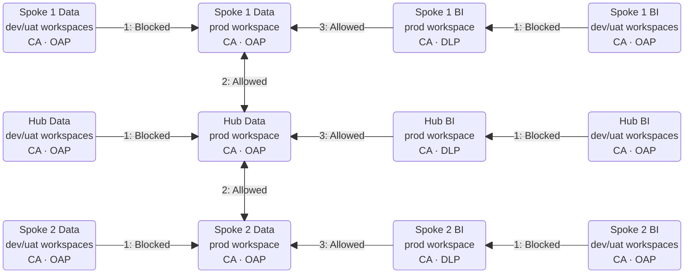

# Hub-and-Spoke Security for Microsoft Fabric: Cross-Domain Sharing Without the Rule Mesh

*How to combine OneLake shortcuts, Outbound Access Protection, Conditional Access and Purview DLP into a governed, scalable Fabric topology*

---

## The problem: every new domain makes the mesh harder

Microsoft Fabric brings data engineering, data integration and business intelligence together over OneLake. That makes it easy for domains to publish reusable data products. It also raises a hard question for security teams: **how do you let domains share data without every domain needing a trusted path to every other domain?**

In a fully connected model, each domain maintains its own connections to the others. The result is a growing rule mesh that adds admin effort and makes security reviews and onboarding harder with every domain you add.

The pattern below replaces those point-to-point dependencies with a **central Hub that acts as the governed exchange layer**. Connectivity becomes **1:many instead of n:n**: each spoke approves the Hub as a destination, and the Hub approves its participating spokes.

## Design goals

The architecture is built to:

- **Keep domain ownership.** Domains stay accountable for their source data, quality and permissions.
- **Provide a governed publication layer** for enterprise and cross-domain use.
- **Block unapproved DEV/UAT access to production** through supported outbound paths.
- **Restrict production Data workspaces** to approved outbound destinations.
- **Separate BI consumption** from data engineering security policy.
- **Simplify connectivity admin** without weakening data authorization.

## The topology at a glance

Workspaces are split three ways: by **domain** (Hub, Spoke 1, Spoke 2), by **workload** (Data vs. BI) and by **lifecycle stage** (DEV/UAT vs. PROD). Spoke 1 and Spoke 2 stand in for any number of domains.



*Figure 1. Fabric workspace security topology. CA = Conditional Access and an approved network location; OAP = Outbound Access Protection; DLP = Microsoft Purview DLP. Arrow labels identify blocked and allowed requests. Arrows indicate access requests, not data movement.*

**How to read the diagram:**

| Marker | Control |
|---|---|
| OAP | **Outbound Access Protection**: no access to public or unapproved destinations |
| CA (all workspaces) | **Entra Conditional Access** + approved network location |
| DLP | **Microsoft Purview DLP** on production BI workspaces |
| 1: Blocked | DEV/UAT workspaces are blocked from reaching PROD by OAP |
| 2: Allowed | Lakehouse allow lists enable bi-directional Hub ↔ spoke access through OAP |
| 3: Allowed | BI workspaces without OAP reach their Data workspaces with no allow lists or managed private endpoints |

**Who owns what:**

| Workspace | Production role | DEV/UAT role |
|---|---|---|
| Spoke Data (1, 2) | Own and publish the domain's data products | Build and test domain engineering workloads |
| Hub Data | Own shared enterprise data; expose approved spoke products | Build and test shared data services |
| Spoke BI (1, 2) | Deliver domain semantic models and reports | Build and test domain BI content |
| Hub BI | Deliver enterprise semantic models and reports | Build and test enterprise BI content |

Each production BI workspace consumes its matching production Data workspace. Anything that crosses domains goes through the Data-layer shortcut structure, so the Hub stays the single governed exchange point.

## Sharing data with OneLake shortcuts

A **OneLake shortcut** points to data in another supported location without making a physical copy. That is what lets a domain publish a data product while keeping ownership of the source.

### Hub ↔ spoke

The Hub Data PROD workspace holds enterprise-owned datasets plus shortcuts to *approved* datasets in each spoke. Each spoke can, in turn, shortcut to enterprise datasets or domain products published through the Hub.

| Consumer | Shortcut path | Purpose |
|---|---|---|
| Hub | Hub Data → Spoke 1 Data | Use approved Spoke 1 products |
| Hub | Hub Data → Spoke 2 Data | Use approved Spoke 2 products |
| Spoke 1 | Spoke 1 Data → Hub Data | Use enterprise or Hub-published products |
| Spoke 2 | Spoke 2 Data → Hub Data | Use enterprise or Hub-published products |

Three points to keep in mind:

- **Arrows are resolution requests**, not replication or write permission.
- **A shortcut doesn't transfer ownership** of its target or automatically grant access to it.
- **All shortcuts here are passthrough**, so the source keeps full control over access.

### Spoke ↔ spoke, through the Hub

Spokes never connect directly. For Spoke 1 to use Spoke 2 data, the Hub first exposes a shortcut to the approved Spoke 2 dataset. Spoke 1 then shortcuts to **that Hub shortcut**:

```text
Spoke 1 Data PROD  →  Hub Data PROD (shortcut)  →  Spoke 2 Data PROD (dataset)
Spoke 2 Data PROD  →  Hub Data PROD (shortcut)  →  Spoke 1 Data PROD (dataset)
```

The consuming spoke **must target the Hub shortcut, not the original dataset**. Pointing straight at the other spoke would bypass the publication path and need a direct connectivity approval.

Fabric evaluates outbound restrictions **at each shortcut hop**. So Spoke 1 → Spoke 2 via the Hub needs two approvals, **Spoke 1 → Hub** and **Hub → Spoke 2**, and no direct Spoke 1 → Spoke 2 approval under the documented chained-shortcut behaviour.

> **The Hub is a logical publication layer.** It isn't a replicated data store, an identity proxy or a way around source permissions. Data stays in its owning lakehouse, and shortcut and target permissions still apply. Keep shortcut chains intentional, shallow and free of circular references.

### Why it scales

| Model | Relationships | Directional approvals (n spokes) |
|---|---|---|
| Direct spoke mesh | Every spoke connects to every other spoke | Up to **n(n − 1)** |
| Hub-and-spoke | Each spoke connects to the Hub, and the Hub to each spoke | About **2n** |

| Spokes (n) | Mesh: n(n − 1) | Hub: 2n |
|---|---|---|
| 2 | 2 | 4 |
| 3 | 6 | 6 |
| 5 | 20 | 10 |
| 10 | 90 | 20 |
| 20 | 380 | 40 |

With only two spokes, the Hub actually adds approvals. The models break even at three spokes, and from four onwards the Hub wins by a widening margin. Just as important, **onboarding a new spoke only needs Hub-facing approvals**, not a connection to every existing spoke.

These are logical workspace relationships for bidirectional sharing, not physical rule or endpoint counts; exact numbers depend on implementation and rule scope. Dataset permissions and publication approval are still maintained for each data product.

## Security controls, layer by layer

### 1. DEV/UAT isolation: OAP

OAP is enabled on **all Data and BI DEV/UAT workspaces**, and production destinations are left off their approved list. Supported outbound operations therefore can't resolve production shortcuts or use unapproved production connections (marker ① in the diagram). DEV/UAT workloads run on non-production data or separately approved, protected test datasets.

> ⚠️ **OAP isn't an identity or deployment boundary.** Direct user reads, admin actions, deployment pipelines and service identities each need their own authorization and lifecycle controls.

### 2. Production Data protection: OAP + allow lists

**All production Data workspaces enable OAP.** Each spoke allows only approved Hub destinations; the Hub allows approved participating spokes (marker ②). Direct spoke-to-spoke destinations aren't in the baseline.

- Unapproved outbound destinations stay blocked for supported operations.
- External sources need explicit review and an approved connection mechanism.
- **Bidirectional sharing needs approval in both directions.** One approval doesn't authorize the reverse.

The exact connection mechanism should follow supported OneLake behaviour in the deployed environment.

### 3. Production BI consumption: no OAP, tighter capacity

Production BI workspaces **don't enable OAP**, so they consume their matching production Data workspace without a BI-side exception (marker ③). Source permissions and target-side inbound restrictions still apply.

To shrink the exfiltration surface further, put BI workspaces on a **capacity with Fabric item creation turned off** (Power BI-only workspaces). That removes notebooks and other code workloads such as user-defined functions from the consumption tier.

### 4. Identity and inbound protection: Conditional Access

**Microsoft Entra Conditional Access** restricts user access by approved network location and organizational identity requirements (the green markers).

Workspace private links and inbound workspace firewall rules can also protect inbound traffic. However, inbound protection doesn't currently support semantic models within or across workspaces. **For now, the recommendation is to leave inbound protection off and rely on Conditional Access with named network locations.**

### 5. Data loss prevention: Purview DLP

**Microsoft Purview DLP** policies cover supported production BI content and activities (the blue markers). They work alongside sensitivity labels, permissions and BI sharing controls to detect or restrict mishandling of sensitive information.

## Key takeaways

1. **Use a Hub as the governed exchange point.** Spokes publish to it and consume through it, never directly from each other.
2. **Use passthrough OneLake shortcuts** so data stays put and the source controls access.
3. **Turn on OAP everywhere except production BI.** It isolates DEV/UAT and limits production Data to Hub-facing destinations.
4. **Keep BI lean.** Use Power BI-only capacity and Purview DLP to cut exfiltration paths.
5. **Use Conditional Access for inbound** until inbound protection supports semantic models.
6. **Remember what each control isn't.** OAP isn't an identity boundary, and the Hub isn't a permission bypass. Layer your controls.

## References

- [Workspace outbound access protection for OneLake](https://learn.microsoft.com/fabric/security/workspace-outbound-access-protection-onelake)
- [OneLake outbound access and connector allowlists](https://learn.microsoft.com/fabric/onelake/onelake-manage-outbound-access)
- [OAP tenant setting](https://learn.microsoft.com/fabric/security/workspace-outbound-access-protection-tenant-setting)
- [Enable workspace OAP](https://learn.microsoft.com/fabric/security/workspace-outbound-access-protection-set-up)
- [Data connection rules](https://learn.microsoft.com/fabric/security/workspace-outbound-access-protection-allow-list-connector)
- [Managed private endpoint approvals](https://learn.microsoft.com/fabric/security/workspace-outbound-access-protection-allow-list-endpoint)
- [Protect inbound traffic](https://learn.microsoft.com/fabric/security/protect-inbound-traffic)
